  

  
  

 

<em>“Words are, in my not-so-humble opinion, our most inexhaustible source of magic.”</em>

  I am <strong>Carel Alberto Karma</strong>, a full-stack engineer and automation builder. 
  I turn raw logic into reliable systems, useful data pipelines, and elegant digital experiences.

  <code>⚡ Currently casting with TypeScript, Python, React &amp; FastAPI</code> 
  <code>🪄 Exploring automation, data engineering &amp; thoughtful product systems</code>

 

<h2 align="center">🐍 Parseltongue</h2>

<em>Languages, frameworks, and magical tools in my core arsenal.</em>

<table align="center">
  <tr>
    <td align="center" width="50%">
      <strong>✨ JavaScript &amp; TypeScript Charms</strong>  
        
      Astro · React · Vite · Node.js · CSS Modules · Tailwind CSS 
      Responsive Design · Mobile-first · 360px support · PWA 
      Web Audio API · Synthesized SFX
    </td>
    <td align="center" width="50%">
      <strong>🧪 Testing &amp; Quality Wards</strong>  
      
        
      Unit Testing · End-to-End Testing 
      Two-context Testing · Oxlint · Quality Assurance
    </td>
  </tr>
  <tr>
    <td align="center" width="50%">
      <strong>⚗️ Python, ML &amp; NLP Potions</strong>  
      
        
      Scikit-learn · SVMSMOTE · TF-IDF · Gradio · FastAPI 
      Pandas · NumPy · SciPy · Statsmodels 
      IBM SPSS · EDA · Data Cleaning
    </td>
    <td align="center" width="50%">
      <strong>🏰 Backend &amp; Database Foundations</strong>  
        
      Native PHP · REST API endpoints 
      Supabase · PostgreSQL · MySQL · Oracle 
      SQL Optimization · Schema Restructuring 
      Docker · Git · Linux
    </td>
  </tr>
  <tr>
    <td align="center" colspan="2">
      <strong>🔭 Visualization &amp; Business Intelligence</strong>  
      
      
      
      
        
      R · Interactive Dashboards · Choropleth Maps · Statistical Storytelling
    </td>
  </tr>
</table>

 

<h2 align="center">🦉 The Enchanted Contribution Map</h2>

Every green light is a spell committed. The starfighter patrols the grid and keeps the dark bugs away.

<picture>
  <source media="(prefers-color-scheme: dark)" srcset="https://raw.githubusercontent.com/Carelyk/Carelyk/galaga-output/galaga-contribution-graph-dark.svg">
  <source media="(prefers-color-scheme: light)" srcset="https://raw.githubusercontent.com/Carelyk/Carelyk/galaga-output/galaga-contribution-graph.svg">
  
</picture>

 

<h2 align="center">🏛️ Find Me Beyond the Castle</h2>

  
  

 

  
<strong>🎧 Open the enchanted gramophone</strong>

   
  

 

<em>Happiness can be found, even in the darkest of times, if one only remembers to turn on the light.</em> ✨

